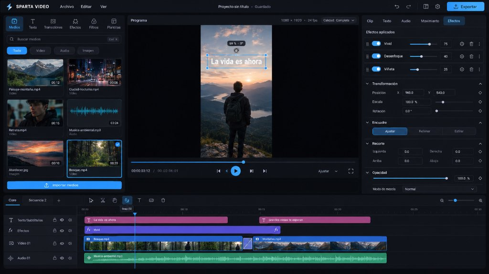
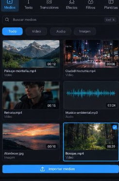
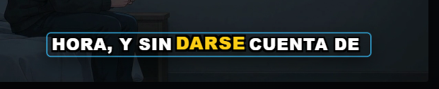
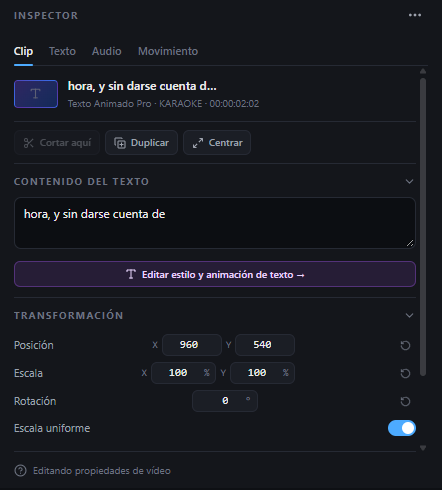
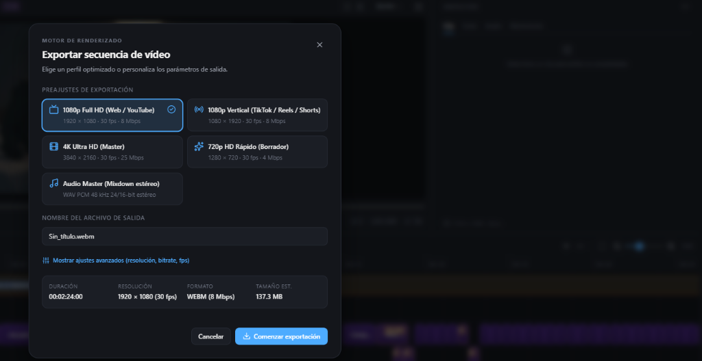
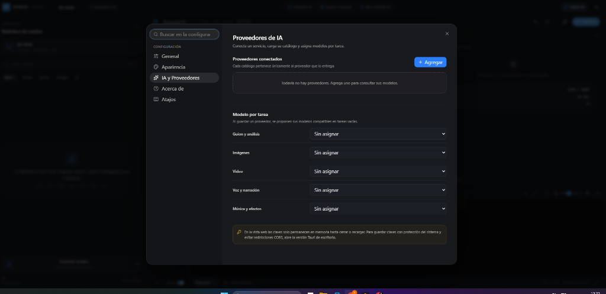
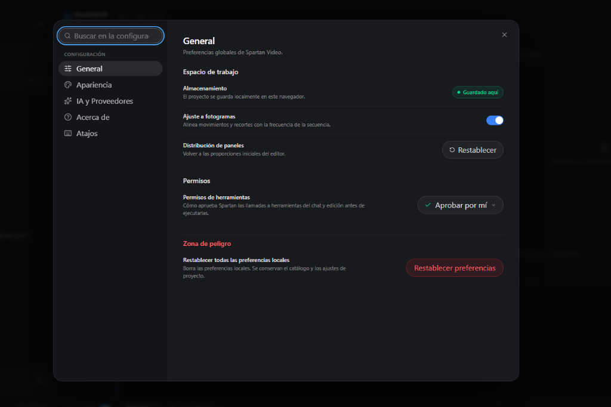
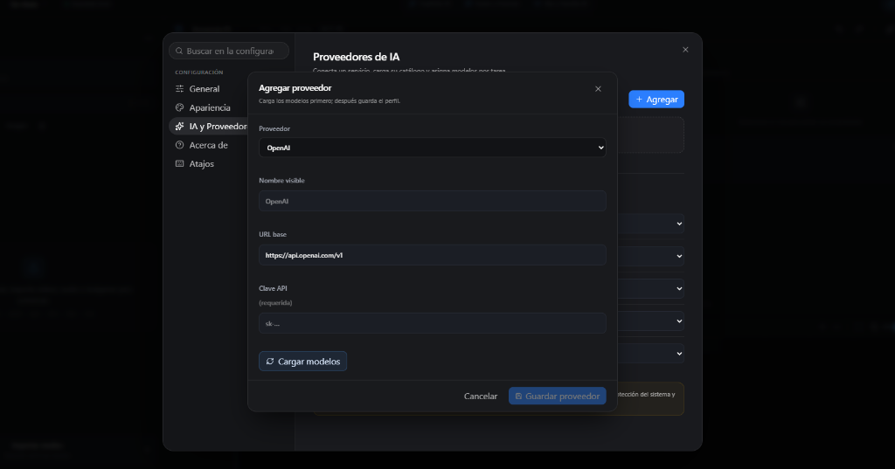

# Sparta Video

> Editor de vídeo de escritorio profesional de alto rendimiento para Windows y Web, construido con **React 19**, **TypeScript**, **Vite** y arquitectura lista para **Rust / Tauri v2**. Combina las mejores prácticas de los entornos de edición no lineal (NLE) estándar de la industria (Adobe Premiere Pro, DaVinci Resolve) con herramientas avanzadas de inteligencia artificial local y en la nube.



---

## 📑 Tabla de Contenidos

- [Visión General](#visión-general)
- [Modos de Ejecución: Escritorio vs Web](#-modos-de-ejecución-aplicación-de-escritorio-vs-navegador-web)
- [Funcionalidades Principales](#funcionalidades-principales)
  - [1. Extracción Automática de Subtítulos con Whisper ASR](#1-extracción-automática-de-subtítulos-con-whisper-asr)
  - [2. Subtítulos Dinámicos y Plantillas Cinéticas](#2-subtítulos-dinámicos-y-plantillas-cinéticas)
  - [3. Calibración y Sincronización Profesional](#3-calibración-y-sincronización-profesional)
  - [4. Monitor de Programa de Alta Precisión](#4-monitor-de-programa-de-alta-precisión)
  - [5. Motor de Renderizado y Exportación](#5-motor-de-renderizado-y-exportación)
  - [6. Copiloto IA y Herramientas Inteligentes](#6-copiloto-ia-y-herramientas-inteligentes)
  - [7. Preferencias y Proveedores de IA](#7-preferencias-y-proveedores-de-ia)
- [Atajos de Teclado](#atajos-de-teclado)
- [Arquitectura Técnica](#arquitectura-técnica)
- [Instalación y Desarrollo](#instalación-y-desarrollo)

---

## 🌟 Visión General

Sparta Video está concebido como una estación de trabajo de vídeo ágil, elegante y precisa. Permite importar vídeos de larga duración (más de 2 minutos sin límites artificiales), extraer automáticamente la voz hablada para transformarla en subtítulos dinámicos estilo TikTok / Reels / YouTube, calibrar cada elemento visual en tiempo real y exportar en múltiples resoluciones con renderizado acelerado.

---

## 🖥️ Modos de Ejecución: Aplicación de Escritorio vs Navegador Web

Sparta Video puede ejecutarse de dos maneras distintas según tu flujo de trabajo:

```
┌─────────────────────────────────────────┬─────────────────────────────────────────┐
│  🚀 MODO ESCRITORIO (Tauri / Rust)      │  🌐 MODO WEB (Navegador)                │
├─────────────────────────────────────────┼─────────────────────────────────────────┤
│ • Comando: `npm run tauri:dev`          │ • Comando: `npm run dev`                │
│ • Renderizado en segundo plano sin      │ • Sin instalación requerida.            │
│   restricciones de FPS ni pausas.       │ • Acceso inmediato desde cualquier      │
│ • Puedes minimizar la app o cambiar de   │   navegador moderno (Chrome, Edge).     │
│   ventana libremente durante el render. │ • Recomendación de rendimiento:         │
│ • Máxima aceleración por hardware       │   Mantener la pestaña en primer plano   │
│   del sistema operativo.                │   durante la exportación/descarga.      │
└─────────────────────────────────────────┴─────────────────────────────────────────┘
```

### ⚡ ¿Por qué se recomienda mantener la pestaña abierta en Modo Web?
Los navegadores web modernos (Chrome, Edge, Brave, Safari, Firefox) aplican políticas automáticas de ahorro de batería y memoria conocidas como *background tab throttling*. Cuando una pestaña pasa a segundo plano o se minimiza, el navegador reduce la frecuencia de temporizadores y bucles de animación (pudiendo bajar de 30/60 FPS a solo 1 FPS o suspender el proceso).

Para mitigar esto, Sparta Video incluye mecanismos avanzados de protección:
1. **Screen Wake Lock API**: Evita que la pantalla y el equipo entren en reposo mientras el vídeo se procesa.
2. **Protección de salida (`beforeunload`)**: Alerta al usuario si intenta cerrar o recargar la pestaña por error con una exportación activa.
3. **Detección de segundo plano (`visibilitychange`)**: Lanza un aviso proactivo si la pestaña pierde el foco durante la renderización.
4. **Telemetría de FPS en tiempo real**: Muestra la cadencia real de cuadros calculados por segundo en el panel de carga.

> [!TIP]
> Si vas a renderizar proyectos extensos de alta resolución en lote mientras trabajas en otras aplicaciones, **utiliza el Modo Escritorio (`npm run tauri:dev`)**. Si prefieres editar al instante sin compilar Rust, usa el **Modo Web** asegurándote de no minimizar la pestaña hasta que la descarga concluya.

---

## 🚀 Funcionalidades Principales

### 1. Extracción Automática de Subtítulos con Whisper ASR

Convierte automáticamente cualquier pista de voz en subtítulos perfectamente sincronizados, sin necesidad de escribir guiones a mano ni subir archivos a servidores externos si se usa procesamiento local.



- **Ejecución en Web Worker dedicado (`whisper.worker.ts`)**: El modelo Whisper de Hugging Face se procesa en segundo plano sin congelar jamás el hilo principal de la interfaz ni la reproducción.
- **Segmentación gramatical inteligente**:
  - Algoritmo que respeta pausas, comas, puntos y signos de interrogación/exclamación.
  - **Sin palabras huérfanas**: Evita que las frases terminen en conectores o preposiciones colgantes (`de`, `que`, `y`, `el`, `la`, `en`, `con`, `sin`, etc.).
- **Detección multilingüe**: Soporte nativo para audio en **Español**, **Inglés** o detección automática de idioma.
- **Tarjeta compacta y plegable**: Panel discreto con selector en una sola línea que puede colapsarse para maximizar el espacio de la biblioteca.

---

### 2. Subtítulos Dinámicos y Plantillas Cinéticas

Crea titulares y subtítulos con el impacto visual de creadores profesionales (estilo Hormozi, documentales de YouTube y vídeos verticales).



- **Estilos incluidos**:
  - **Hormozi Karaoke Pro**: Resaltado de palabra por palabra en tiempo real con color de acento ajustable y micro-animación de escala.
  - **Pop Pill Dinámico**: Subtítulo moderno encapsulado en pastilla flotante con entrada elástica.
  - **Cine Subtítulo 4K**: Tipografía clásica y elegante con sombra cinematográfica para producciones narrativas.
  - **Titular Impact Hook**: Letras en mayúsculas de gran tamaño con zoom dramático para captar la atención en los primeros segundos.
  - **Cyber Neón Cinético**: Efecto de glitch digital y resplandor neón futurista.
  - **Lower Thirds y Títulos de Tercio**: Fichas para nombres de presentadores y temas.
- **Vistas previas en vivo al pasar el ratón (Hover Previews)**:
  - Al posicionar el cursor sobre cualquier plantilla en el panel izquierdo, las palabras se animan en bucle mostrando exactamente cómo entrará el texto en el vídeo final.
  - Respeta las preferencias del sistema operativo (`prefers-reduced-motion`).

---

### 3. Calibración y Sincronización Profesional

Ajusta con precisión milimétrica la apariencia y el ritmo de los subtítulos sin tener que repetir el trabajo clip a clip.



- **Calibración directa en el Monitor**:
  - Arrastra el subtítulo directamente en el monitor de programa con el ratón en los ejes X e Y para ubicarlo donde no tape rostros o elementos clave.
  - Guía de selección discreta con contorno punteado fino que se oculta automáticamente durante la reproducción.
- **Controles en el Inspector**:
  - **Altura Y y Tamaño de fuente**: Ajuste instantáneo del tamaño y de la posición vertical en pantalla.
  - **Micro-ajuste individual (±0.1s)**: Adelanta o retrasa un subtítulo específico para cuadrar la dicción exacta.
  - **Sincronización global de pista (±0.05s / ±0.2s)**: Si toda la pista tiene un ligero desfase, sincroniza todos los clips a la vez con un solo clic.
  - **Botón "Aplicar posición y tamaño a todos los subtítulos"**: Calibra un subtítulo perfecto y copia su altura, tamaño, escala y estilo a toda la pista automáticamente.

---

### 4. Monitor de Programa de Alta Precisión

Un visor de programa diseñado bajo los estándares de las suites NLE de referencia.

- **Ajuste automático inteligente (`Fit`)**: Utiliza `ResizeObserver` para adaptar el lienzo a cualquier relación de aspecto (16:9, 9:16 vertical, 1:1 cuadrado, 21:9 ultra-panorámico) sin distorsiones ni cortes.
- **Niveles de Zoom**: Opciones rápidas de zoom: `Ajustar`, `50%`, `100%` y `200%`, con desplazamiento fluido.
- **WYSIWYG 1:1 con la exportación**: Los tamaños de fuente, sombras, bordes y paddings se calculan exactamente con la misma métrica relativa que el motor de renderizado final.
- **Scrubber de precisión profesional**:
  - Barra de búsqueda fina que se expande al interactuar.
  - **Tooltip de tiempo flotante**: Muestra una línea guía blanca y el código de tiempo exacto al pasar el cursor sobre la barra.
- **Código de tiempo interactivo**:
  - Haz clic en el código de tiempo para escribir directamente el punto de salto (`01:24`, `12.5`, `00:01:05:12`).
- **Navegación entre marcadores**: Botones dedicados de salto a marcador anterior y siguiente (`StepBack` / `StepForward`).
- **Guías visuales de emisión**: Márgenes de seguridad de emisión y regla de composición por tercios.

---

### 5. Motor de Renderizado y Exportación

Exporta tus creaciones con perfiles optimizados para cada plataforma o ajusta los parámetros avanzados a tu medida.



- **Perfiles preconfigurados**:
  - 🖥️ **1080p Full HD (Web / YouTube)**: 1920 × 1080 · 30 fps · 8 Mbps · Formato WebM/MP4.
  - 📱 **1080p Vertical (TikTok / Reels / Shorts)**: 1080 × 1920 · 30 fps · 8 Mbps · Optimizado para móvil.
  - 🎬 **4K Ultra HD (Master)**: 3840 × 2160 · 30 fps · 25 Mbps · Máxima definición para archivo y cine.
  - ⚡ **720p HD Rápido (Borrador)**: 1280 × 720 · 30 fps · 4 Mbps · Render ultrarrápido para revisiones.
  - 🎵 **Audio Master (Mixdown estéreo)**: WAV PCM 48 kHz 24/16-bit estéreo sin pérdidas.
- **Telemetría técnica en vivo**: Indicadores en tiempo real de Duración, Resolución, Formato y Tamaño estimado de archivo.
- **Ajustes avanzados**: Control manual de ancho, alto, cadencia (24 fps cinemático, 30 fps estándar, 60 fps fluido) y tasa de bits (bitrate de 1 a 50 Mbps).

---

### 6. Copiloto IA y Herramientas Inteligentes

Automatiza tareas repetitivas de edición con el asistente integrado de Sparta Video.



- **Cerrar huecos / Compactar**: Elimina espacios vacíos entre clips en un solo clic.
- **Auto-Marcadores**: Detecta puntos de corte y cambios de ritmo en el material.
- **Mezcla IA**: Nivelación suave y balanceo de volumen automático entre pistas de diálogo y música de fondo.
- **Reencuadre 9:16**: Adapta material horizontal a formato vertical con seguimiento del sujeto.
- **Generador de Guiones y Escaletas**: Chat interactivo con contexto directo de la secuencia para redactar locuciones y propuestas de edición.

---

### 7. Preferencias y Proveedores de IA

Configura tu entorno de trabajo y conecta tus propios modelos de lenguaje y servicios de procesamiento.

<div align="center">
  
  
</div>

- **Almacenamiento Local Robusto**: Todo el contenido multimedia se guarda localmente en IndexedDB utilizando blobs optimizados para tiempos de carga inmediatos.
- **Conectores de Proveedores IA**: Configura claves API para OpenAI, modelos compatibles con protocolo v1 o servicios locales sin dependencias cerradas.
- **Distribución calibrable**: Ajusta el tamaño de la línea de tiempo, monitor e inspector con persistencia entre sesiones.

---

## ⌨️ Atajos de Teclado

| Atajo | Acción |
| :--- | :--- |
| `Espacio` | Reproducir / Pausar secuencia |
| `V` | Herramienta de Selección |
| `C` | Herramienta de Cuchilla (Razor cut en el punto clicado) |
| `S` | Dividir clip activo en la posición del cabezal |
| `M` | Añadir marcador en el cabezal |
| `←` / `→` | Retroceder / Avanzar un fotograma |
| `Shift + ←` / `Shift + →` | Saltar 1 segundo atrás / adelante |
| `Inicio` / `Fin` | Ir al inicio / final de la secuencia |
| `Ctrl + Z` | Deshacer última acción |
| `Ctrl + Shift + Z` / `Ctrl + Y` | Rehacer acción |
| `Ctrl + +` / `Ctrl + -` | Zoom in / Zoom out en la línea de tiempo |
| `Ctrl + 0` | Encajar línea de tiempo al espacio disponible |
| `Supr` / `Backspace` | Eliminar clip o marcador seleccionado |
| `Alt + Supr` / `Alt + Backspace` | Borrar todos los subtítulos de la secuencia (con opción Deshacer) |

---

## 🛠️ Arquitectura Técnica

- **Frontend**: React 19, TypeScript, Vite, Tailwind CSS / Vanilla CSS optimizado para bajo consumo de GPU.
- **Gestión de Estado**: Zustand con inmutabilidad estricta y sincronización reactiva de pistas, clips, keyframes y marcadores.
- **Motor de Audio**: Web Audio API con mezcla multipista, decodificación local a 16 kHz para Whisper y renderizado a WAV PCM de 16 bits.
- **Motor de IA Local**: `@huggingface/transformers` en Web Worker dedicado con cuantización ONNX Runtime Web.
- **Exportación**: MediaRecorder API con soporte para WebM (VP9/Opus) y Canvas 2D renderizado cuadro a cuadro con interpolación Hermite cúbica.
- **Pruebas y Calidad**: Vitest con jsdom (75/75 pruebas unitarias passing), ESLint con reglas estrictas.

---

## 💻 Instalación y Desarrollo

### Requisitos previos
- **Node.js** v20 o superior
- **npm** v10 o superior

### Pasos de instalación

1. **Clonar el repositorio e instalar dependencias:**
   ```bash
   git clone https://github.com/tu-usuario/sparta-video.git
   cd sparta-video
   npm install
   ```

2. **Ejecutar en Modo Web (Navegador):**
   ```bash
   npm run dev
   ```
   Abre [http://localhost:5173](http://localhost:5173) en tu navegador.

3. **Ejecutar en Modo Escritorio (Tauri / Rust):**
   ```bash
   npm run tauri:dev
   ```
   Abre la ventana nativa de Sparta Video sin dependencia de pestañas de navegador.

4. **Compilar el instalador de escritorio para Windows:**
   ```bash
   npm run tauri:build
   ```
   Genera el instalador ejecutable `.msi` / `.exe` en `src-tauri/target/release/bundle/`.

5. **Ejecutar pruebas unitarias automatizadas:**
   ```bash
   npm test
   ```

6. **Verificar calidad de código y linter:**
   ```bash
   npm run lint
   ```

7. **Compilar la versión web de producción:**
   ```bash
   npm run build
   ```

---

<div align="center">
  <sub>Desarrollado con pasión para creadores y editores de contenido de alto calibre.</sub>
</div>
