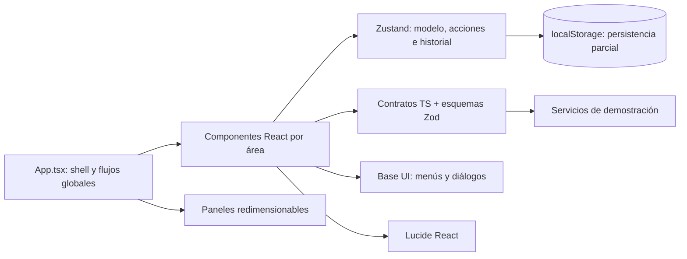
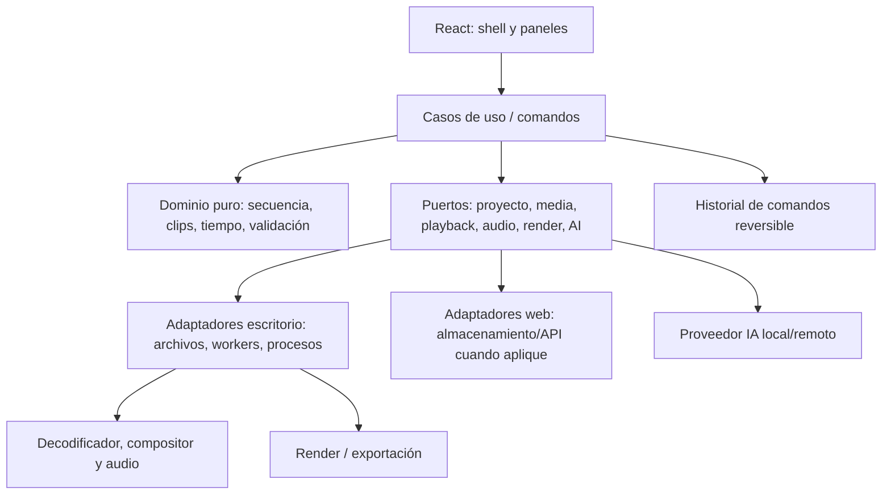

# Sparta Video — interfaz, arquitectura y plan del editor con IA

**Actualizado:** 23 de octubre de 2026  
**Alcance:** documento maestro único de la interfaz: inventario real, estructura del código, arquitectura objetivo, investigación de referencias y trabajo pendiente.  
**Estado actual:** prototipo local de edición estructural. No es todavía un editor audiovisual real.

> Este documento distingue lo que el repositorio ya implementa de la propuesta para el producto. La captura de referencia orienta el diseño, pero no demuestra que una función esté conectada. La revisión visual en navegador queda pendiente; los límites conocidos se anotan en el seguimiento.

## 1. Resumen

Sparta Video tiene una interfaz de escritorio con biblioteca, monitor, inspector, asistente y línea de tiempo multipista. React presenta el estado; Zustand mantiene el modelo de demostración y el historial; los contratos TypeScript/Zod definen entradas para servicios simulados. La UI ya permite organizar clips y editar algunos valores del modelo.

La aplicación **no conserva los archivos importados, no decodifica ni reproduce vídeo/audio, no compone una secuencia real, no exporta un archivo y no conecta un proveedor de IA**. El monitor y las ondas son ilustraciones. No se deben presentar como funciones reales.

El objetivo de producto es un **editor de vídeo con IA** (interpretación basada en el contexto de Sparta Video): edición multipista no destructiva, medios recuperables, reproducción y exportación reales, y asistencia de IA que propone cambios revisables. El asistente no debe alterar el proyecto sin aprobación explícita.

## 2. Inventario de interfaz actual

| Zona | Componente / código | Funciona hoy | Límite actual |
| --- | --- | --- | --- |
| Barra superior | `src/App.tsx` | Proyecto, ajustes de secuencia, deshacer/rehacer, estado de guardado, preferencias, asistente y exportación | El estado de guardado corresponde al almacenamiento del navegador. El avatar es decorativo; duplicar proyecto está deshabilitado. |
| Biblioteca | `MediaLibraryPanel.tsx` | Buscar, filtrar vídeo/audio/imagen, ordenar, lista/cuadrícula, seleccionar, importar fichas y arrastrarlas | La ficha conserva metadatos básicos, no el archivo ni una ruta recuperable. Miniaturas no provienen del medio. |
| Monitor | `PreviewMonitor.tsx` | Reloj de muestra, scrub, controles de cuadro, bucle, guías, zoom y pantalla completa | Muestra ilustración, no el cuadro actual de la secuencia. La calidad solo cambia su etiqueta. |
| Inspector | `InspectorPanel.tsx` | Pestañas Clip/Audio/Movimiento, transformación, opacidad, mezcla, volumen, fundidos y datos de keyframes | Guarda valores en el modelo; no procesa imagen/sonido. Los keyframes no se interpolan. |
| Línea de tiempo | `TimelinePanel.tsx` | Selección, movimiento, recorte, Razor, pistas, marcadores, snapping, zoom, scroll sincronizado y expansión | Cambia datos de muestra; no sincroniza ni compone medios. |
| Asistente | `AssistantPanel.tsx` | Borrador, sugerencias y envío a respuesta de demostración | No hay proveedor conectado; no aplica propuestas. Adjuntos/proveedor no están conectados. |
| Preferencias | `PreferencesSheet.tsx` | Drawer lateral redimensionable con navegación General/Apariencia/Atajos; animación, snapping, layout y atajos consultables | Tema oscuro único; escala de interfaz no implementada. Mantiene el formato lateral en ventanas estrechas y deja visible parte del editor. |
| Exportación | `ExportDialog.tsx` | Opciones de muestra, progreso cancelable y resultado dentro del diálogo | No crea archivo ni usa códec. |

### 2.1 Interacciones que ya están conectadas

- **Proyecto:** renombrar, cambiar resolución/fps, deshacer/rehacer y restaurar la distribución de paneles. El modelo guarda una parte de la secuencia en `localStorage`, no en un archivo portable.
- **Biblioteca:** el clic selecciona; el doble clic intenta insertar en una pista compatible; también se puede arrastrar desde la biblioteca. Soltar archivos cataloga datos y puede omitir tipos no admitidos.
- **Línea de tiempo:** arrastrar el cuerpo mueve clips; las asas del clip seleccionado recortan. Ajuste al cuadro y, dentro de 8 px, alineación visual con cabezal, marcador o borde de otro clip. Durante el gesto se ve inicio, duración y delta. Un clip puede seleccionarse para usar flechas; `Alt + flechas` recorta el borde derecho, `Ctrl + Alt + flechas` el izquierdo; `Shift` usa un paso de un segundo. En la región de pistas las flechas mueven el cabezal.
- **Razor:** `C` activa la herramienta; clic sobre el clip divide en el punto indicado si ambas partes son válidas. `V` vuelve a selección.
- **Marcadores:** `M` añade en el cabezal; clic navega al tiempo; foco + Supr/Retroceso o clic derecho elimina. `[` y `]` navegan entre marcadores.
- **Atajos globales:** `Space` reproduce/pausa la simulación; `Ctrl/Cmd+Z` y `Ctrl/Cmd+Shift+Z` deshacen/rehacen; `Ctrl/Cmd+K` busca medios. El contexto de entrada y controles interactivos evita capturas globales accidentales.
- **Scroll:** biblioteca, asistente, preferencias y línea de tiempo tienen áreas internas. Pistas y controles de pista comparten el desplazamiento vertical; la regla queda fija. No se debe necesitar el scroll vertical de página para editar.

### 2.2 Estados que la interfaz debe comunicar

La biblioteca distingue `demo`, `catalog-only`, `ready`, `processing`, `missing`, `error` y estado desconocido. `processing` es visual de muestra; no representa una tarea ejecutándose. Relocalizar un medio está deshabilitado porque todavía no existe una referencia durable. Importar no equivale a guardar el archivo fuente.

Las etiquetas de estado de producto deben corresponder a hechos observables: **Conectado**, **Demostración**, **Pendiente**, **Deshabilitado** o **Error**. El éxito de un mock nunca debe leerse como éxito de decodificación, guardado portable, IA aplicada o exportación.

### 2.3 Shell de Preferencias

El panel de Preferencias es un drawer anclado a la derecha, no una ventana de pantalla completa. Su ancho inicial compacto es 460 px, se puede ajustar entre 360 y 560 px, y conserva una franja del editor detrás incluso en ventanas pequeñas. La navegación por categorías permanece a la izquierda; el contenido agrupa cada ajuste en filas compactas con descripción y control alineado, para dar prioridad a la lectura sin desperdiciar espacio. Se mantiene una cabecera estable, cierre accesible y estados existentes. En viewports de hasta 640 px se reduce el ancho y la navegación; debajo de 390 px se compactan las etiquetas. Estas decisiones responsive son una inferencia de diseño para respetar el flujo lateral pedido y evitar el drawer a pantalla completa. La escala sigue deshabilitada y el único tema disponible es Sparta oscuro.

**Referencias consultadas:** [Preferencias de Adobe Premiere](https://helpx.adobe.com/premiere/desktop/get-started/preferences-and-settings/general-preferences.html) organiza ajustes en categorías; [administrar espacios de trabajo de Premiere](https://helpx.adobe.com/premiere/desktop/get-started/tour-the-workspace/manage-workspaces.html) documenta la restauración del espacio; el [patrón de diálogo modal WAI-ARIA](https://www.w3.org/WAI/ARIA/apg/patterns/dialog-modal/) orienta cierre, foco y teclado, y [WCAG 2.2: foco no oculto](https://www.w3.org/WAI/WCAG22/Understanding/focus-not-obscured-minimum) advierte que el foco no quede totalmente tapado. Las referencias aportan patrones, mientras que el ancho y comportamiento exactos son decisiones de diseño de Sparta.

## 3. Arquitectura existente



### 3.1 Archivos y responsabilidades actuales

```text
src/
├── App.tsx                              # shell, atajos, importación y flujos globales
├── App.css                              # estilos de la mayor parte de la UI
├── index.css                            # base CSS y tokens importados
├── styles/
│   ├── tokens.css                       # variables visuales semánticas
│   └── editor-polish.css                # refinamientos de interacción/paneles
└── features/editor/
    ├── model.ts                         # tipos y datos iniciales de demostración
    ├── editor-store.ts                  # estado, acciones, historial y persistencia parcial
    ├── timecode.ts                      # conversión temporal y regla
    ├── components/
    │   ├── MediaLibraryPanel.tsx        # biblioteca y catálogo
    │   ├── PreviewMonitor.tsx            # monitor ilustrativo
    │   ├── InspectorPanel.tsx            # propiedades del elemento seleccionado
    │   ├── TimelinePanel.tsx             # timeline, pistas y gestos
    │   ├── AssistantPanel.tsx            # asistente de demostración
    │   ├── PreferencesSheet.tsx          # preferencias y lista de atajos
    │   ├── ExportDialog.tsx              # diálogo y resultado simulado
    │   ├── RenameProjectDialog.tsx       # cambio de nombre
    │   ├── ActionMenu.tsx / controls.tsx # primitivas de interacción reutilizables
    └── services/
        ├── contracts.ts                 # contratos/esquemas de servicios
        └── mock-services.ts              # implementaciones falsas
```

### 3.2 Dependencias presentes

| Paquete | Uso actual | Decisión para el producto |
| --- | --- | --- |
| React / React DOM | Componentes y renderizado | Conservar. |
| TypeScript | Modelo, propiedades y contratos | Conservar y compartir contratos entre UI y servicios. |
| Zustand | Estado común, historial, persistencia parcial | Conservar para UI; mover reglas editables a operaciones de dominio puras. |
| `react-resizable-panels` | Divisores y layout | Conservar; añadir límites y presets de espacio de trabajo. |
| `@base-ui/react` | Menús y diálogos | Conservar como base accesible. |
| `lucide-react` | Iconografía actual | Mantener un solo sistema de iconos; iconos con nombre accesible y tamaño/grosor coherentes. |
| Zod | Validación de entradas/resultados | Conservar para límites de servicios y propuestas de IA, no como sustituto de reglas de dominio. |
| Vite / Tailwind | Desarrollo/build; Tailwind está instalado | No mezclar dos sistemas visuales sin una migración deliberada; CSS propio es el predominante hoy. |
| Vitest / Testing Library / ESLint | Calidad estática y pruebas existentes | Usar en criterios de aceptación, con pruebas solicitadas o aprobadas para cada bloque. |

No están presentes/conectados FFmpeg, demuxer/decodificador, motor de audio, renderizador real, formato portable de proyecto ni proveedor de IA. La elección del motor debe esperar a pruebas de compatibilidad, rendimiento, licencias, peso de instalación y plataforma.

## 4. Sistema visual y reglas de interacción

- **Tokens:** `src/styles/tokens.css` fija superficies, texto, acento, estados, tipografía, espaciado y radios. `editor-polish.css` todavía convive con el CSS monolítico; `App.css` requiere división gradual por panel.
- **Texto:** escala base de 11, 12, 13, 15 y 18 px. El tamaño pequeño se reserva a etiquetas de densidad alta; no reducir más sin una justificación y revisión de contraste.
- **Contraste:** validar texto normal frente a 4.5:1 y componentes/estados no textuales frente a 3:1, sobre todos sus fondos reales. El token `--text-dim` es más legible que grises puntuales antiguos. La auditoría global aún no está terminada.
- **Foco:** todos los controles de teclado necesitan foco visible, contrastante y no oculto por encabezados/pies fijos. La UI tiene una regla global `:focus-visible`; falta revisar todos los componentes y tamaños.
- **Movimiento:** respetar `prefers-reduced-motion` y la preferencia de animación del editor; el movimiento decorativo no debe comunicar por sí mismo estado crítico.
- **Acciones:** un control visible hace algo, o está deshabilitado y explica por qué. Evitar botones decorativos, duplicados o etiquetas que aparenten un servicio conectado.
- **Iconos:** usar `lucide-react` existente; iconos decorativos se ocultan del lector de pantalla y botones de icono reciben nombre, tooltip y estado.
- **Errores y tareas:** mostrar progreso, cancelación, reintento y recuperación junto a la tarea propietaria. No reemplazar un fallo por una notificación de éxito ambigua.

## 5. Estructura de UI objetivo

### 5.1 Shell y espacios de trabajo

1. **Barra superior:** identidad, nombre/estado del proyecto, secuencia y acciones globales (deshacer/rehacer, preferencias, IA y exportar). Mantener guardado en un solo sitio y con detalle accesible.
2. **Biblioteca:** árbol de bins/carpetas, búsqueda y filtros, lista/cuadrícula, columnas de metadatos, miniaturas reales, estados de medio, inserción y relocalización.
3. **Monitor de programa:** cuadro real en el cabezal, transporte, timecode, resolución de vista previa, guías, overlays y asas de transformación sincronizadas con inspector.
4. **Inspector:** propiedades por contexto (clip, pista, secuencia), grupos plegables, unidades y límites, keyframes navegables y restablecimiento granular.
5. **Línea de tiempo:** regla y cabezal, pistas objetivo, clips con rangos fuente, overlays de audio, transiciones/efectos, marcadores, snapping, selección múltiple, herramientas, zoom, encaje y feedback del gesto.
6. **Asistente IA:** contexto explícito, historial, tarea/progreso, operación propuesta y panel de revisión. No debe cubrir controles del editor ni cambiar la selección de forma inesperada.
7. **Exportación:** preset, formato/códec, tamaño/fps/audio, destino, peso/tiempo estimado, cola/progreso, cancelar y acceso al archivo final.

### 5.2 Responsive/ventanas compactas

- Objetivos para revisar: 1920×1080, 1440×900, 1280×720 y 1024×768, además de cambios de altura y DPI.
- Mantener la app contenida en la ventana; cada panel desplaza su contenido en su propia región. Mantener sincronizados nombres/pistas y regla/cabezal.
- En ventanas estrechas, esconder controles secundarios antes de las acciones principales. Actualmente se ocultan el deslizador y el porcentaje de zoom de timeline bajo 820 px; acercar, alejar y encajar siguen disponibles.
- La distribución adaptable del monitor/inspector, biblioteca y asistente necesita una pasada visual real. No afirmar que esta matriz ya está validada.

## 6. Requisitos funcionales de un editor de vídeo con IA

### 6.1 Proyecto y biblioteca

- Crear, abrir, guardar, guardar como, recientes, autoguardado recuperable, migraciones y respaldo.
- Formato portable versionado con secuencias, bins, pistas, rangos fuente, efectos y referencias de medios; evitar guardar archivos de vídeo completos dentro de almacenamiento web.
- Importación en lote con resumen por archivo, metadatos reales, miniaturas, audio waveforms, progreso, cancelación, formatos incompatibles y errores accionables.
- Estado online/offline y flujo de relocalización verificable; distingir original, proxy, transcodificado y generado por IA. La referencia durable debe sobrevivir al reinicio.
- Organización por bins, etiquetas, favoritos, búsqueda por metadatos y columnas configurables.

### 6.2 Edición, reproducción y audio

- Edición no destructiva: clip = referencia al medio + rango de origen + rango de secuencia + transformaciones/efectos; el medio original no se modifica al cortar o mover clips.
- Operaciones de selección, inserción/sobrescritura, mover, trim, ripple/roll, slip/slide, Razor, transiciones, marcadores, multi-selección, pistas objetivo, bloquear/silenciar/solo.
- El motor conserva una base temporal coherente, orden de capas y reglas explícitas de snapping/solapes. Los gestos generan una operación del historial, no cientos de acciones sueltas.
- Vista previa sincronizada con el cabezal y audio maestro; caché, proxies, calidad adaptable y señal de cuadros perdidos; teclado y scrub no bloquean UI.
- Audio: waveform derivada, niveles, keyframes, fundidos, mezcla, monitorización y render final coherentes.
- Motion: keyframes con interpolaciones explícitas, editor de curvas y navegación entre keyframes.

### 6.3 IA integrada al flujo creativo

- Casos de uso iniciales: resumir secuencia, buscar/marcar momentos, proponer selects, organizar tomas, subtítulos/títulos, sugerir ritmo, detectar silencios y proponer cambios de montaje.
- Separar **análisis informativo**, **generación de activos** y **operaciones sobre edición**; cada una explica datos usados, proveedor, coste/tiempo si aplica y destino de los datos.
- La IA entrega operaciones tipadas y validadas (p. ej. mover/dividir clip, añadir marcador, cambiar propiedad), no código ejecutable ni escritura libre al store.
- Presentar resumen, clips/propiedades afectados, justificación y vista previa; permitir incluir/excluir cada operación, editar, aplicar, rechazar, cancelar y deshacer como una sola transacción.
- Mostrar generaciones anteriores, regenerar variaciones y mantener procedencia (modelo, fecha, prompt/ajustes cuando sea apropiado, activo producido). Diferenciar medios originales y sintéticos.
- El consentimiento y la configuración de privacidad deben preceder al envío de metadatos, transcripciones o fotogramas a servicios remotos. Poder limitar contexto y borrar historial.
- Estados de experiencia: listo, recopilando contexto, requiere confirmación, generando, revisando, parcial (reglas inválidas explicadas), aplicado, cancelado y error/reintento.

### 6.4 Exportación

- Presets claros y editables, destino, códec/contenedor, resolución, fps, audio, rango de render y estimaciones.
- Encolar render fuera del hilo de UI; progreso por etapa, pausa/cancelación si el motor lo permite, recuperación y mensajes accionables.
- Confirmar archivo creado, ruta, propiedades inspeccionadas y reproducción verificable. Hasta entonces, mantener la demo identificada.

## 7. Arquitectura objetivo e integración



- Mantener componentes visuales sin lógica de códecs o llamadas de IA. El store coordina estado de interfaz; reglas de tiempo y edición viven en dominio comprobable.
- Definir puertos con contrato para `ProjectRepository`, `MediaIngestService`, `ThumbnailService`, `PlaybackEngine`, `AudioEngine`, `RenderService` y `AIProvider`.
- Cada tarea larga informa progreso, cancelación, resultado y errores tipados. Proveedores demo y reales implementan el mismo puerto.
- Aplicar operaciones de IA y gestos de edición como un comando validado, reversible y agrupado; la UI recibe el resultado del comando y no simula que se aplicó antes de confirmarlo.
- Evaluar WebCodecs, FFmpeg/WASM o un proceso nativo con prototipos de formatos objetivo; después decidir empaquetado de escritorio (Tauri/Electron u otro) según soporte, rendimiento, licencias, tamaño, seguridad y acceso a archivos.

### 7.1 Estructura de carpetas propuesta (a migrar gradualmente)

```text
src/
├── app/                 # shell, rutas, composición de paneles
├── features/
│   ├── project/         # abrir/guardar, recuperación y preferencias
│   ├── media/           # ingestión, bins, metadatos y relocalización
│   ├── timeline/        # edición, herramientas, selección y regla
│   ├── preview/         # playback, composición y overlays
│   ├── inspector/       # propiedades y keyframes
│   ├── assistant/       # contexto, propuesta y revisión IA
│   └── export/          # presets, cola, progreso y resultados
├── domain/              # tipos, reglas, comandos, historial, validadores
├── services/            # puertos y adaptadores mock/real
├── ui/                  # botones, campos, menús, toast, diálogo y estados
└── styles/              # tokens, base, shell y CSS por panel
```

## 8. Flujo de revisión del asistente

1. Usuario selecciona el alcance (proyecto, secuencia, selección o medios) y solicita análisis/propuesta.
2. UI muestra qué contexto enviará y si será remoto; usuario confirma datos sensibles y adjuntos.
3. Adaptador de IA devuelve salida estructurada contra esquema versionado; se valida contra el estado actual y reglas de dominio.
4. UI muestra cada operación, elemento afectado, razón, advertencia, impacto y vista previa sin mutar el proyecto.
5. Usuario puede editar/excluir pasos y luego aplicar seleccionados; se registra un comando undo atómico.
6. Registrar estado/error/versión del proveedor y procedencia necesaria; permitir cancelar, deshacer y reportar una propuesta incorrecta.

La propuesta no debe incluir JavaScript, rutas arbitrarias, comandos del sistema ni acceso directo al almacenamiento. Resolver por el adaptador qué datos se mandan y usar minimización de contexto. La política final de retención/proveedores sigue pendiente de una decisión de producto.

## 9. Ruta priorizada y criterios de salida

| Fase | Entrega | Criterio de salida |
| --- | --- | --- |
| 0. Integridad de UI | Un solo mapa de interfaz; estados honestos, controles accesibles, CSS organizado y flujos coherentes | Cada clic tiene resultado o motivo; sin página desbordada; paneles/timeline legibles y navegación por teclado coherente. |
| 1. Proyecto y medios | Archivo portable versionado, rutas recuperables, relink, bins y metadata/miniaturas reales | Cerrar/reabrir restaura proyecto; medio ausente se identifica y relocaliza sin cambiar el montaje. |
| 2. Playback y composición | Decodificación, caché/proxies, monitor real, orden de capas, transformaciones y audio | Scrub/reproducción coinciden con secuencia; cortes y transformaciones se reflejan cuadro a cuadro. |
| 3. Edición/audio | Operaciones de timeline, mezcla, keyframes interpolados y waveform | Operaciones válidas y reversibles, sincronía AV comprobada. |
| 4. Render | Presets, destino, cola, progreso/cancelación y validación de archivo | Archivo reproducible con dimensiones/fps/audio solicitados. |
| 5. IA revisable | Contexto/privacidad, propuesta tipada, comparación, aplicación reversible y procedencia | Sin aprobación no cambia nada; aprobación solo aplica operaciones válidas y todo se puede deshacer. |
| Transversal | Accesibilidad, rendimiento, documentación y recuperación | Teclado, foco, lector de pantalla, errores y límites documentados en cada fase. |

**Próxima tarea UI:** completar auditoría visual de 1920×1080, 1440×900, 1280×720 y 1024×768, empezando por scroll vertical/horizontal de timeline, zona inferior, foco y anchos mínimos. La última tentativa de captura no pudo confirmar la URL del navegador; no se marca QA visual como terminado.

## 10. Referencias investigadas

Las referencias siguientes sirven para derivar prácticas de interacción y criterios; no prueban que Sparta ya las implemente ni obligan a copiar una solución de proveedor.

| Referencia primaria | Aplicación al diseño Sparta |
| --- | --- |
| [Adobe Premiere: edición de vídeo](https://helpx.adobe.com/premiere/desktop/edit-projects/intro-to-editing/edit-video-in-premiere.html) | Confirma que mover, cortar, recortar y edición no destructiva son acciones base; conservar originales y hacer explícita la herramienta/acción de timeline. |
| [Atajos oficiales de Premiere](https://helpx.adobe.com/premiere/desktop/get-started/keyboard-shortcuts/default-keyboard-shortcuts.html) y [navegación por teclado](https://helpx.adobe.com/premiere/desktop/get-started/set-up-accessibility-features/navigate-premiere-using-the-keyboard.html) | El panel enfocado es contexto de atajos; ofrecer panel activo visible, acceso por teclado y acciones de edición sin depender solo del ratón. |
| [Adobe: crear proyectos e importar/organizar](https://helpx.adobe.com/premiere/desktop/organize-media/create-projects/create-new-project.html) | Proyecto, destino, bins, ajustes y decisiones de importación son pasos visibles; se puede preparar metadata/transcripción mientras se continúa editando. |
| [Adobe: ingestión, copia, transcodificación y proxies](https://helpx.adobe.com/premiere/desktop/organize-media/ingest-proxy-workflow/configure-ingest-settings.html) | Diferenciar originales, copias y proxies; mostrar proceso de fondo y permitir editar con proxy sin perder vínculo al original. |
| [Adobe: relocalizar medios offline](https://helpx.adobe.com/premiere/desktop/organize-media/file-organization/locate-and-link-offline-files.html) y [proxies](https://helpx.adobe.com/premiere/desktop/organize-media/ingest-proxy-workflow/attach-proxies-to-full-resolution-media.html) | Estado offline accionable, matching de más de un dato y flujo por lote; no considerar un simple catálogo como biblioteca durable. |
| [Adobe: herramienta generativa en la timeline](https://helpx.adobe.com/premiere/desktop/edit-projects/edit-with-generative-ai/generative-media-tool-overview.html) | La IA puede aparecer en contexto del rango seleccionado y devolver medios editables, con posibilidad de regenerar/revisar dentro del montaje. |
| [Microsoft HAX Toolkit](https://www.microsoft.com/en-us/haxtoolkit/) y [patrones HAX](https://www.microsoft.com/en-us/haxtoolkit/design-patterns/) | Diseñar el ciclo completo de solicitud, expectativa, fallo, corrección y recuperación de la IA desde temprano. |
| [W3C WCAG 2.2: foco visible](https://www.w3.org/WAI/WCAG22/Understanding/focus-visible) y [contraste no textual](https://www.w3.org/WAI/WCAG22/understanding/non-text-contrast.html) | Revisar foco visible y contraste de controles/indicadores frente a fondos adyacentes, no solo el color de texto. |
| [W3C WCAG 2.2: foco no oculto](https://www.w3.org/WAI/WCAG22/Understanding/focus-not-obscured-minimum) | Evitar que reglas fijas, overlays o paneles tapen completamente el elemento enfocado. |
| [NIST: perfil de riesgos de IA generativa](https://nvlpubs.nist.gov/nistpubs/ai/NIST.AI.600-1.pdf) | Registrar procedencia de contenido generado y comunicar origen/historial de activos sintéticos. |

**Síntesis / inferencia:** la práctica coherente para Sparta es mantener IA dentro del contexto de edición, devolver resultados revisables y editables, explicar qué datos viajan y permitir recuperar errores; las acciones creativas siguen bajo control de la persona. Se deriva de las referencias de interacción, accesibilidad y flujos de Premiere, no de una implementación ya conectada.

## 11. Seguimiento de implementación

Integrado en el prototipo: escala tipográfica y tokens iniciales; biblioteca con filtros/estados más honestos; monitor ilustrativo con transporte y controles; inspector con propiedades; línea de tiempo con regla adaptativa, snapping, guía, etiquetas de gesto, marcadores, scroll sincronizado y atajos; exportación demo en diálogo; menús/diálogos Base UI; paneles redimensionables; docs en español. Preferencias usa un drawer lateral compacto y redimensionable, categorías laterales, filas de ajustes densas, y una adaptación estrecha que evita cubrir toda la pantalla.

Pendiente: terminar división de `App.css`; auditoría WCAG completa y lector de pantalla; revisión visual capturada por tamaños; foco y gestos alternativos en cada control; acceso portable a proyecto/medios; decodificación, composición/audio y render reales; proveedor de IA con privacidad y revisión de operaciones. En el prototipo el timecode secundario del monitor se elevó al token semántico de texto para dar más margen de contraste.

**Validación de código:** `npm run lint`, `npm run build` y `git diff --check` pasaron durante la última continuación de UI. La compilación avisó que el paquete JS principal supera 500 kB minificado; no se cambiaron límites ni se ejecutaron pruebas en esa pasada. Las comprobaciones de código no equivalen a QA visual.
