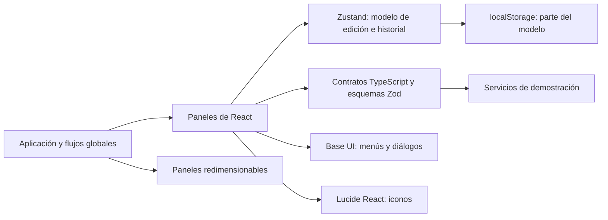

# Sparta Video — inventario funcional de la interfaz

**Revisión:** 23 de octubre de 2026  
**Estado del producto:** demostración local de edición estructural; todavía no es un editor de vídeo/audio real.  
**Propósito:** registrar qué partes de la interfaz existen, qué hace cada clic, cómo se conectan los componentes y qué servicios siguen simulados.

Este documento describe el código que hay hoy. Las capturas y especificaciones compartidas orientan el diseño, pero no se consideran prueba de que una función esté conectada. Cuando un control tiene una etiqueta literal en inglés, se conserva entre comillas para que se pueda localizar en la aplicación; la explicación está en español.

## Resumen ejecutivo

La aplicación ya tiene un espacio de edición multipista con estado compartido, historial para acciones de edición, ajustes de secuencia, preferencias, guardado local del modelo y controles principales conectados. La biblioteca, el inspector, el monitor ilustrativo y la línea de tiempo comparten parte del mismo modelo.

La edición actual modifica **datos de una secuencia de demostración**. La aplicación todavía no conserva los archivos importados, no decodifica ni reproduce sus imágenes o sonido, no compone las capas y no crea un archivo exportado. El monitor costero y las formas de onda son ilustraciones. Las acciones de IA y exportación usan proveedores simulados.

| Ya funciona en la demostración | Simulado, limitado o pendiente |
| --- | --- |
| Seleccionar, mover, recortar y dividir clips; añadir pistas y marcadores; deshacer y rehacer | Decodificar archivos de vídeo o audio, reproducirlos y sincronizarlos |
| Ajustar resolución, frecuencia de cuadro, snapping y zoom de la línea de tiempo | Componer capas y aplicar de verdad mezcla, volumen, fundidos o fotogramas clave |
| Buscar, filtrar, ordenar y catalogar datos básicos de medios | Mantener una referencia recuperable al archivo fuente, generar miniaturas o formas de onda reales |
| Cambiar propiedades del clip y ver una representación gráfica simplificada | Renderizar y guardar un vídeo final |
| Guardar una parte del modelo del proyecto en el almacenamiento local del navegador | Crear/abrir proyectos portables, copias de seguridad, sincronización o recuperación externa |
| Mostrar el resultado real del guardado y ofrecer reintento | Conectar un proveedor de IA que aplique propuestas al proyecto |

## Pantalla y responsabilidad de cada área

| Área | Componente principal | Qué hace el usuario | Estado real y límites |
| --- | --- | --- | --- |
| Barra superior | `src/App.tsx` | Abrir el menú del proyecto, cambiar secuencia, deshacer/rehacer, mostrar el asistente, abrir preferencias y exportación | Renombrar y ajustes sí cambian el modelo. Duplicar solo informa que no está disponible. El avatar «JD» es decorativo. El estado de guardado sí refleja la escritura local. |
| Biblioteca de medios | `MediaLibraryPanel.tsx` | Buscar, filtrar por vídeo/audio/imagen, ordenar, seleccionar, importar, arrastrar o hacer doble clic en un medio | Importar solo valida y cataloga nombre, tipo y tamaño. No guarda el objeto `File`, una ruta persistente ni una miniatura del archivo; la fila no garantiza que el archivo siga disponible después. |
| Monitor de programa | `PreviewMonitor.tsx` | Reproducir/pausar un reloj de demostración, avanzar o retroceder un cuadro, mover el tiempo y activar superposiciones | Muestra una escena ilustrativa de costa, no el contenido de los archivos ni una composición de clips. «FULL/HALF/QUARTER» cambia la etiqueta, no la calidad de decodificación. |
| Inspector | `InspectorPanel.tsx` | Editar propiedades de clip en Clip, Audio y Motion; plegar secciones; restablecer valores y copiar el nombre | Los valores se guardan en el modelo. No se aplican a audio/vídeo real y los fotogramas clave no interpolan. Las pistas bloqueadas dejan sus clips en solo lectura. |
| Línea de tiempo | `TimelinePanel.tsx` | Seleccionar, mover, recortar, cortar con Razor, buscar tiempo, arrastrar medios, gestionar pistas, marcadores, snapping, zoom y expansión | Modifica datos del modelo, no un motor multimedia. La regla permite arrastrar el cabezal. Al desplazarse verticalmente, las pistas y sus controles permanecen sincronizados; la regla queda fija. |
| Asistente Sparta AI | `AssistantPanel.tsx` | Usar sugerencias, escribir y enviar consultas, cerrar o volver a abrir el panel | La respuesta procede de un proveedor simulado y no cambia el proyecto. Selector de proveedor y adjuntos están deshabilitados. |
| Preferencias | `PreferencesSheet.tsx` | Cambiar categoría, snapping, animaciones, proporciones del espacio y consultar atajos/guardado | Las animaciones se guardan en este navegador. Escala de interfaz está deshabilitada. Solo se presenta el tema oscuro; no existe selector de tema. |
| Renombrar proyecto | `RenameProjectDialog.tsx` | Escribir, guardar o cancelar un nombre | Actualiza el nombre del modelo y su copia local. No crea un archivo de proyecto. |
| Exportación | Diálogo de `src/App.tsx` | Editar un nombre de salida y ejecutar/cancelar la demostración | El progreso es simulado y cancelable. No se escribe ningún archivo de vídeo. |

## Flujos de clic, menús y diálogos

### Proyecto y barra superior

- Al hacer clic en el nombre del proyecto se abre **«Project actions»**. **«Rename project»** abre el diálogo de nombre; **«Project preferences»** abre Preferencias. **«Duplicate project»** muestra un aviso de función pendiente y no duplica nada.
- **«Undo»** y **«Redo»** restauran operaciones compatibles del historial. No incluyen el tiempo de reproducción, el zoom, la herramienta activa ni la distribución de paneles.
- **«Sequence settings»** ofrece 1920×1080, 1280×720 o 1080×1920 y 24, 30 o 60 fps. Cambia los datos de secuencia, la presentación del monitor de muestra, el timecode y el snapping; no cambia un render real.
- El indicador superior muestra «Demo · not saved», «Saved in this browser», «Saving…» o «Save failed». Cuando falla, **«Retry»** intenta escribir de nuevo el estado actual del proyecto. El pie de la línea de tiempo y Preferencias presentan el mismo estado.
- El estado «Saved in this browser» significa que se escribió el subconjunto serializado en `localStorage`. No significa que exista un archivo `.sparta`, una copia portable o un respaldo.
- En ventanas compactas el asistente se pliega para dejar más espacio al editor. Los divisores pueden redimensionar los paneles; **«Reset layout»** restaura proporciones iniciales.

### Biblioteca de medios

- **«Search media»** filtra por nombre; el botón × limpia el texto. `Ctrl/Cmd+K` enfoca ese campo.
- **«Filter media»** limita la lista a todo, vídeo, audio o imágenes. **«Library options»** también permite ordenar por nombre y escoger el tipo. El contador indica cuántos resultados se muestran.
- Un clic selecciona la tarjeta y muestra el medio seleccionado en el inspector. Doble clic lo inserta en la primera pista compatible desbloqueada. Arrastrar la tarjeta sobre una pista lo inserta en esa pista; soltar sobre el área general busca una pista compatible abierta.
- **«Import media»** abre el selector del sistema para vídeo, audio e imágenes. Se validan nombre y tipo MIME básico; los archivos no compatibles se omiten y se muestra un recuento. No se conserva el archivo seleccionado ni su ruta: se añade una ficha de catálogo con metadatos básicos.
- Los medios de imagen se pueden filtrar y distinguir con su icono. Al insertarlos, el modelo los representa en una pista de vídeo con duración de demostración; aún no existe un fotograma de imagen fuente.
- Si no hay resultados se muestra un mensaje vacío. La tarjeta del proyecto abre Preferencias; no abre una pantalla de gestión de proyectos.

### Monitor e inspector

- **Play/Pause** inicia o detiene el reloj de muestra; las flechas del monitor avanzan un cuadro según los fps activos. `Space` reproduce/pausa cuando el foco no está en un control interactivo.
- Arrastrar el cabezal sobre la regla busca el tiempo; con **Snap** activado se alinea a un cuadro. El desplazamiento horizontal se tiene en cuenta.
- En el menú del monitor, **«Safe margins»** y **«Title overlay»** activan guías ilustrativas. El selector de calidad solo cambia el texto FULL/HALF/QUARTER.
- La pestaña **Clip** edita posición, escala, rotación, escala uniforme, opacidad y modo de mezcla del clip. La imagen de muestra refleja algunas propiedades visuales, pero no usa los píxeles del medio.
- **Audio** cambia volumen y fundidos de entrada/salida almacenados; aún no se oyen. **Motion** agrega o quita puntos de posición/escala en el tiempo actual; todavía no hay interpolación.
- El menú del inspector permite restablecer valores o copiar el nombre del clip. Copiar muestra un aviso de éxito o de error del portapapeles. Las secciones del inspector se pliegan al pulsar su encabezado.
- Si se seleccionó un medio sin clip, **«Add to timeline»** intenta insertarlo en el cabezal actual. Si la pista compatible está bloqueada o no existe, la acción no cambia el proyecto y se muestra un aviso.

### Línea de tiempo — zona inferior

- La regla muestra segundos y permite buscar con clic o arrastre. El cabezal se alinea a cuadros cuando **Snap** está activo. La regla se mantiene fija en la parte superior al desplazarse entre pistas.
- El cuerpo de un clip se arrastra para moverlo; los extremos del clip seleccionado se arrastran para recortarlo. La duración mínima es un cuadro. Con **Snap** activo, los cambios se cuantizan a la frecuencia de cuadro de la secuencia.
- **«Select (V)»** activa selección. **«Razor (C)»** divide el clip justo donde se hace clic y alinea el corte al cuadro. Si el corte queda demasiado cerca del borde para formar dos clips válidos, el modelo no lo divide.
- **«Add marker at playhead»** crea un marcador en el tiempo actual. Clic en un marcador lleva el cabezal a su tiempo; clic derecho lo elimina. La eliminación por clic derecho es una limitación de accesibilidad y no tiene aún un control visible alternativo.
- **«Add track»** permite crear pistas de vídeo o audio. Las acciones de mute y bloqueo cambian el estado del modelo; solo el bloqueo limita la edición en el modelo. Mute aún no procesa sonido.
- Cuando varias partes se solapan dentro de una pista, se colocan en subfilas para que las etiquetas no se tapen. Las pistas y sus controles laterales comparten el desplazamiento vertical. La cuadrícula y la regla usan la misma escala temporal.
- **«Fit sequence»** encuadra el rango de clips y marcadores; el deslizador y los botones cambian el zoom entre 25% y 240%. **«Expand timeline»** oculta temporalmente monitor/inspector para dar más alto a las pistas.
- **«Show clip names»** y **«Show audio waveforms»** cambian la representación. La forma de onda se genera con datos decorativos, no a partir del sonido fuente.
- Arrastrar un archivo desde la biblioteca tiene en cuenta la posición horizontal desplazada. Las pistas bloqueadas no aceptan inserciones.

### Preferencias, asistente y exportación

- **General:** el estado de guardado refleja el del proyecto; **«Timeline snapping»** comparte estado con el botón Snap; **«Reset layout»** restaura paneles.
- **Appearance:** **«Interface animations»** guarda la preferencia en este navegador. El tema oscuro es el único tema. **«UI scale»** aparece deshabilitado y explica que no está implementado.
- **Shortcuts:** las categorías son pestañas accesibles; flechas arriba/abajo, izquierda/derecha, Inicio y Fin mueven el foco entre pestañas.
- **Asistente:** las sugerencias copian texto al borrador; `Enter` envía y `Shift+Enter` agrega una línea. La respuesta simulada no realiza acciones. La selección de proveedor y los adjuntos están deshabilitados porque no hay servicio de IA.
- **Export:** el diálogo muestra nombre, formato MP4/H.264, resolución, fps y duración calculada. El botón **«Export preview»** ejecuta un progreso de demostración. Cancelar, Escape, × o clic fuera detienen la simulación. No se crea un archivo ni se ejecuta un códec.

## Qué se guarda y qué no

| Dato | ¿Se guarda en `localStorage`? | Observaciones |
| --- | --- | --- |
| Nombre, ajustes de secuencia, pistas, clips, medios catalogados, marcadores, ajuste a cuadros, silencio y bloqueo | Sí | Es una parte del modelo, sin formato portable ni migraciones de proyecto completas. |
| Reproducción, cabezal, zoom, selección, herramienta e historial undo/redo | No | Son estado de vista o historial de sesión. |
| Archivo binario importado, ruta persistente, fotogramas, forma de onda real | No | La importación actual no conserva referencias fuente utilizables tras cerrar. |
| Preferencia de animaciones | Sí | Preferencia separada del modelo del proyecto. Si falla el almacenamiento, se mantiene solo en la sesión. |
| Distribución de paneles | Sí, con fallback en memoria | Si el navegador bloquea almacenamiento, los cambios de layout duran hasta cerrar la sesión. |

## Arquitectura y conexiones



- `src/App.tsx` coordina paneles, atajos, selección, notificaciones, importación, estado de guardado y diálogo de exportación.
- `src/features/editor/model.ts` define clips, pistas, medios, secuencia y marcadores, además de los datos iniciales de demostración.
- `src/features/editor/editor-store.ts` contiene el modelo común, sus acciones, reglas de bloqueo, historial y persistencia parcial.
- `src/features/editor/components/` contiene la biblioteca, monitor, inspector, línea de tiempo y asistente, menús y diálogos.
- `src/features/editor/services/contracts.ts` declara interfaces y esquemas de validación. `mock-services.ts` implementa el catálogo, una propuesta de IA consultiva y un progreso de exportación de muestra.
- `src/App.css` define el diseño y la mayor parte de los estilos. `src/index.css` importa Tailwind y declara tokens semánticos base; la interfaz no está construida principalmente con clases utilitarias Tailwind.

La regla de capas es: la UI presenta el estado y emite acciones; el store valida y modifica el modelo; los servicios cumplen contratos. Los servicios mock no decodifican, mezclan, componen, renderizan ni consultan un modelo real.

## Librerías, iconos y utilidades

| Paquete | Uso encontrado | Evaluación |
| --- | --- | --- |
| React y React DOM | Interfaz y composición de componentes | Base de la aplicación. |
| TypeScript | Tipos del modelo, props, contratos y servicios | Base de desarrollo; no es dependencia de ejecución del navegador. |
| Zustand y `persist` | Estado compartido, historial y guardado parcial | Conectado. El proyecto no está versionado como archivo portátil. |
| `react-resizable-panels` | Paneles de biblioteca, editor, asistente, monitor e inspector | Conectado; distribuciones con fallback si falla almacenamiento. |
| `@base-ui/react` | Primitivas de menú y diálogos de preferencias/renombrado | Conectado para interacciones y accesibilidad. |
| `lucide-react` | Iconos de biblioteca, inspector, controles de pistas, acciones y menús | Sistema de iconos visual existente; no se mezcla con paquetes adicionales de iconos. |
| Zod | Validar metadatos, opciones de exportación y propuesta de IA | Conectado a contratos y servicios simulados; no reemplaza validación del motor multimedia. |
| Vite y plugin de React | Desarrollo local y compilación | Herramientas de desarrollo y empaquetado web. |
| Tailwind CSS y plugin de Vite | Instalados e importados | Disponibles, pero el editor actual usa estilos CSS propios. No conviene añadir utilidades Tailwind por duplicado sin migrar el sistema visual. |
| Vitest, Testing Library, `user-event`, jsdom y ESLint | Pruebas de store, contratos, utilidades e interfaz; análisis estático | Herramientas de desarrollo y validación, no parte del producto ejecutado. |

No aparecen instalados ni conectados en esta fase: FFmpeg, un demuxer/decodificador, motor de audio, servicio de render, backend de proyectos o proveedor de IA. La decisión de añadirlos corresponde a las fases funcionales posteriores y requiere fijar formatos y plataforma objetivo.

## Inventario de archivos principales

```text
src/
├── App.tsx                              # disposición global, atajos, diálogos y flujos
├── App.css / index.css                  # estilos del editor y tokens base
├── main.tsx                             # montaje de React
└── features/editor/
    ├── model.ts                         # tipos y datos iniciales de muestra
    ├── editor-store.ts                  # estado, acciones, historial y persistencia
    ├── timecode.ts                      # timecode y marcas de regla
    ├── components/
    │   ├── MediaLibraryPanel.tsx        # buscar, filtrar e importar
    │   ├── PreviewMonitor.tsx           # monitor ilustrativo y transporte
    │   ├── InspectorPanel.tsx           # propiedades del elemento seleccionado
    │   ├── TimelinePanel.tsx            # pistas, clips, regla, zoom y gestos
    │   ├── AssistantPanel.tsx           # conversación de demostración
    │   ├── PreferencesSheet.tsx         # preferencias y atajos
    │   ├── RenameProjectDialog.tsx      # diálogo de nombre
    │   ├── ActionMenu.tsx / controls.tsx # componentes reutilizables
    └── services/
        ├── contracts.ts                 # interfaces y esquemas Zod
        └── mock-services.ts             # implementaciones simuladas
```

## Pendientes ordenados por dependencia

1. **Proyecto y medios:** modelo de proyecto versionado, crear/abrir/guardar/guardar como, guardar referencias recuperables, relocalizar medios, validar rutas y generar metadatos/miniaturas reales.
2. **Reproducción y composición:** decodificar formatos acordados, mostrar el fotograma correcto al mover el cabezal, definir rangos fuente, orden de capas, transformaciones y sincronización de audio.
3. **Audio y movimiento:** forma de onda real, mute/volumen/fundidos aplicados, keyframes con interpolación y curvas.
4. **Render:** escoger motor/formato compatibles, crear archivo, informar progreso/errores, cancelar y comprobar salida reproducible.
5. **IA revisable:** definir proveedor y política de privacidad, adjuntar contexto, mostrar cambios propuestos, aplicar/rechazar y deshacer como una operación.

La prioridad inmediata de UI es completar flujos accesibles y estados de error, revisar la eliminación de marcadores por teclado/táctil y validar visualmente ventanas de distintos tamaños. La funcionalidad multimedia no se debe presentar como conectada hasta que exista un servicio real que la ejecute.

## Validación del estado documentado

En la última pasada de implementación se ejecutaron `npm run lint`, `npm run build` y `npm test -- --run`: lint y compilación terminaron correctamente; las pruebas reportaron **40 pruebas aprobadas**. Estas comprobaciones validan código y comportamientos simulados; no certifican reproducción, exportación ni aspecto visual en todos los tamaños de pantalla.

Para ver los pasos por control, consulta la [guía funcional](../GUIA_UI.md). La [especificación de producto](PRODUCT-SPEC.md) conserva principios y fases objetivo.


